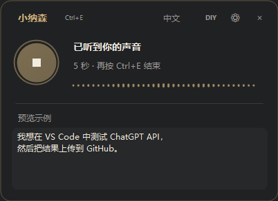
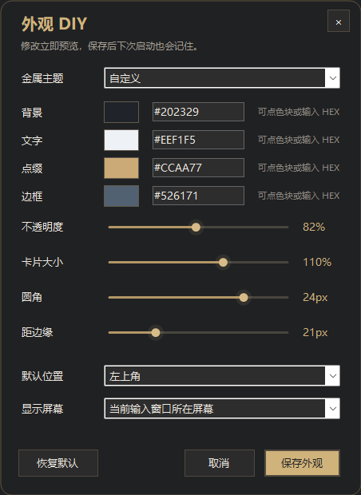

<p align="center"></p>

<p align="center"><strong>简体中文</strong> · <a href="README.en.md">English</a></p>

<p align="center"></p>

<p align="center">
  <a href="https://github.com/Haierr/xiaonasen/releases/latest"></a>
  <a href="https://github.com/Haierr/xiaonasen/actions/workflows/windows.yml"></a>
  <a href="LICENSE"></a>
  
</p>

<p align="center"><a href="https://github.com/Haierr/xiaonasen/releases/latest"><strong>下载小纳森 · Download Xiaonasen</strong></a> &nbsp; / &nbsp; <a href="#安装">快速开始</a> &nbsp; / &nbsp; <a href="README.en.md#get-started">English guide</a></p>

# 小纳森 · Xiaonasen

轻量、本地的 Windows 中文语音输入。按 **Ctrl+E** 开始说话，整理后直接填入原输入框；录音中按 **T**，把中文口述翻译成英文。

一枚小咖啡，一次快捷键，让口述变成文字。原生 Windows 界面，本地识别与整理，中文口述也可以写成英文。

## 一眼了解

| 轻巧地留在桌面 | 看得见的收音反馈 | 说中文，写英文 |
| --- | --- | --- |
| 待机圆圈 · 平滑展开 · 5 秒收回 | 音量波形 · 状态提示 · 中文预览 | 录音时按 T · 结束后翻译并填入 |

<p align="center"></p>

<p align="center"><sub>界面示例 · UI preview</sub></p>

## 功能

- **小咖啡待机**：左上角圆圈，开始录音时平滑展开，完成后闲置 5 秒自动收回。
- **有收音反馈**：真实音量驱动波形，状态提示正在聆听或已听到声音，文字每几秒更新。
- **中文 / 中→英**：录音时按 T 来回切换，结束时以最后选定的模式输出。
- **去口水词与重复**：保守整理，术语表辅助英文与专有名词拼写。
- **鼠标穿透**：默认可点击浮窗后面的按钮；按住 Alt 临时操作浮窗。
- **外观 DIY**：金属配色、透明度、大小、圆角、位置、多屏跟随。
- **按需加载**：模型空闲默认 30 秒后卸载，待机不监听麦克风。
- **保留发送决定**：只粘贴文字，不自动按回车；输入窗口切换后改为保留结果供复制。

## 安装

需要 Windows 10 / 11 x64、.NET Framework 4.8，以及可用的系统麦克风。已验证的引擎为 llama.cpp b10034 Vulkan 版；显卡驱动需支持 Vulkan，纯 CPU 的速度和兼容性需按设备核对。源码和轻量发行包均不包含约 1.5 GB 的 ASR 模型。

1. 从 [Releases](https://github.com/Haierr/xiaonasen/releases) 下载 `xiaonasen-*-windows-x64.zip`，解压到可写目录，例如 `D:\Xiaonasen`。
2. 在解压目录运行：

   ```powershell
   powershell -NoProfile -ExecutionPolicy Bypass -File .\setup-runtime.ps1
   ```

   该参数只应用于这一次 PowerShell 进程。脚本从上游准备固定版本引擎、整理资源和模型，检查 SHA-256；首次下载需要联网及约 2 GB 可用磁盘空间。下载中断后可重新运行，保留 `.part` 续传。
3. 双击 **xiaonasen.exe**。如果需要手动配置，可将 `settings.example.json` 复制为 `settings.json` 再编辑。默认使用系统麦克风，模型位于程序旁的 `runtime/`。

已有兼容运行环境时，也可避免重复下载：

```powershell
powershell -NoProfile -ExecutionPolicy Bypass -File .\setup-runtime.ps1 -SourceRuntime "D:\ExistingApp\runtime"
```

程序未使用代码签名。请从本仓库的 Release 下载，并用 `SHA256SUMS.txt` 检查包的完整性。不要为了使用程序关闭系统防护。

## 怎么用

| 操作 | 行为 |
| --- | --- |
| 点进输入框，再按 **Ctrl+E** | 开始录音，展开浮窗 |
| 录音中单独按 **T** | 中文输出 ↔ 中文翻译成英文；松开 Ctrl+E 后再按 |
| 再按 **Ctrl+E** | 结束录音，整理并按选定语言填入原输入框 |
| 按住 **Alt** | 允许点击、复制、拖动或右键浮窗 |
| 托盘右键 | 设置、词表、DIY、查看上次结果、切换语言、释放模型、退出 |

T 只在录音期间占用，结束、取消、处理或退出后恢复普通打字。默认 Ctrl+E 在程序运行时会覆盖其他应用中相同的快捷键。快捷键被其他工具占用时会显示提示，仍可从托盘或 Alt 点击操作。

录音上限 90 秒。首次识别或模型卸载后需几秒准备，音频会立即开始收录。实时预览仍显示中文；英文模式在录音结束后翻译。数字、名字和专业内容请核对。输入框不支持 Ctrl+V、窗口权限等级不同等情况可能需要手动复制。

## 外观与术语

从托盘选择“外观 DIY”，或按住 Alt 点击顶部 DIY。可调整香槟金、铂金银、玫瑰金及自定义 HEX 配色，选择所在屏幕、四角位置或手动拖动。修改即时预览，保存后保留，取消则恢复。



在“设置与词表”的录音快捷键输入框中按下新组合键，点击保存即可生效，无需重启。支持 Ctrl 或 Alt 加字母、数字、功能键等；占用冲突时保留原快捷键。默认 Ctrl+E，录音中的 T 切换不变。

从“设置与词表”选择麦克风、自动粘贴、整理、默认输出语言和模型卸载时间。`terms.txt` 每行一个词；公开版本只提供通用技术词，不包含开发者的个人词表。

## 资源与隐私

原生 WinForms 界面，无 Python/WebView 常驻。录音仅保存在本机内存；识别、整理和翻译请求发往本机 `127.0.0.1:18902`，不上传录音，不记录口述历史。安装资源下载会访问 GitHub 和 ModelScope；程序本身不自动下载、不做更新检查。

一台开发用 Windows 设备上测得模型卸载后的界面工作集约 **43 MB**，8 秒待机 CPU 样本接近 0%，启动至输入空闲约 **0.8 秒**。这些是单机观察，不是跨设备保证，也不包含识别时的模型内存/显存。40 次展开/收回及 10 次快速反向动画测试没有出现 GDI/USER 对象增长。[验证说明](docs/TESTING.md)。

## 从源码构建

```powershell
git clone https://github.com/Haierr/xiaonasen.git
cd xiaonasen
powershell -NoProfile -ExecutionPolicy Bypass -File .\build.ps1
# 没有模型也可运行界面与快捷键检查
powershell -NoProfile -ExecutionPolicy Bypass -File .\scripts\test.ps1
# 准备运行资源；较大文件仅保留在 dist/runtime，不进入 Git
powershell -NoProfile -ExecutionPolicy Bypass -File .\scripts\setup-runtime.ps1
```

输出为 `dist/xiaonasen.exe`。构建使用 Windows 自带 .NET Framework 编译器，无 NuGet 包依赖。`scripts/package.ps1` 使用明确的文件名单生成轻量 ZIP，避免把本地设置、日志或模型打包。[开发与测试](CONTRIBUTING.md)。

## 来源与许可

MIT。ASR 协议与文字整理能力参考 [Saymore v1.2.0](https://github.com/frankzch/Saymore/tree/v1.2.0)，保留 frankzch 的版权与许可。本项目使用 Qwen3-ASR、Saymore 的整理 LoRA 和 llama.cpp，资源按各自上游许可使用。咖啡图案为 AI 生成素材，提示词保存在 `assets/coffee-prompt.txt`。[第三方说明](THIRD_PARTY_NOTICES.md)。

---

<p align="center"><strong>小纳森 · Xiaonasen</strong><br>说得自然，写得轻松。<br><a href="README.en.md">Read the complete English guide →</a></p>
